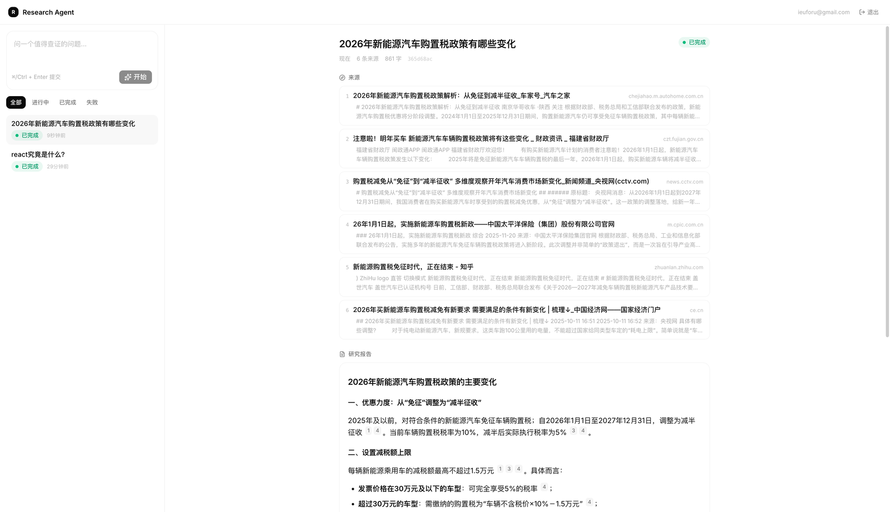

# research-agent

[](https://github.com/ieuforu/research-agent/actions/workflows/ci.yml)

A small research workbench: submit a question, the backend plans search queries,
retrieves sources, and streams a cited report back to the browser.



Built primarily as a **learning vehicle for the stack** (pnpm monorepo, TanStack
Router/Query, Fastify 5, Drizzle, Postgres, SSE streaming), not as a product.

## Stack

| Layer        | Choice                                                                |
| ------------ | --------------------------------------------------------------------- |
| Monorepo     | pnpm workspace, single root lockfile, hoisted toolchain               |
| Frontend     | React 19, Vite 8, TanStack Router + Query, jotai, Base UI, Tailwind 4 |
| Backend      | Fastify 5, Drizzle ORM, zod, Node ESM                                 |
| Data         | PostgreSQL 17 (docker compose)                                        |
| LLM / search | DeepSeek (`openai` SDK, OpenAI-compatible) + Tavily (optional)        |
| Tooling      | oxlint, oxfmt, TypeScript 7 native (`tsc`), `tsrs` as a fast checker  |

## Quick start — Docker (recommended)

```bash
cp .env.example .env        # fill in JWT_SECRET and DEEPSEEK_API_KEY
docker compose up -d --build
```

Open <http://localhost:8080>, register, and ask a question. That is the whole
setup: postgres, migrations, the API and the built frontend all come up in one
command. `JWT_SECRET` and `DEEPSEEK_API_KEY` have no insecure defaults on
purpose — compose fails with a message telling you which one is missing.

| Service    | Image                | Notes                                               |
| ---------- | -------------------- | --------------------------------------------------- |
| `postgres` | `postgres:17-alpine` | named volume, healthchecked                         |
| `server`   | `server/Dockerfile`  | runs migrations, then binds `:3000` (not published) |
| `web`      | `web/Dockerfile`     | nginx on `:8080`, serves the SPA and proxies `/api` |

## Quick start — local dev

```bash
pnpm install
docker compose up -d postgres          # only the database
cp server/.env.example server/.env     # then fill in DEEPSEEK_API_KEY and JWT_SECRET
pnpm --filter server db:migrate
pnpm dev:server                        # :3000
pnpm dev:web                           # :5173 (proxies /api to :3000)
```

Open <http://localhost:5173>. The dev server proxies `/api` to `:3000`, so the
same frontend build works in both setups.

## Commands

| Command                                        | Purpose                                        |
| ---------------------------------------------- | ---------------------------------------------- |
| `pnpm check`                                   | gate: `fmt:check && lint && typecheck && test` |
| `pnpm dev:web` / `pnpm dev:server`             | dev servers                                    |
| `pnpm build`                                   | web production build                           |
| `pnpm typecheck`                               | official `tsc` across all packages             |
| `pnpm typecheck:fast`                          | `tsrs` (Rust port of TS7), local feedback only |
| `pnpm test`                                    | vitest across all packages                     |
| `pnpm lint` / `lint:fix` / `fmt` / `fmt:check` | oxlint / oxfmt                                 |

`typecheck:fast` is deliberately **not** part of `pnpm check`: it tracks a
`TS 7.1.0-dev` prerelease, so the required gate stays on the official compiler.

## API

| Endpoint                        | Behaviour                                                                 |
| ------------------------------- | ------------------------------------------------------------------------- |
| `POST /api/research`            | `{question}` → `202` + task (executes in the background)                  |
| `GET /api/research`             | keyset paginated: `?limit=1..100&cursor=&status=` → `{tasks, nextCursor}` |
| `GET /api/research/:id`         | full task including `report` and `sources`                                |
| `POST /api/research/:id/cancel` | `200` cancelled, `409` if already terminal, `404` unknown                 |
| `GET /api/research/:id/stream`  | SSE: `status`, `sources`, `token`, `done`, `error`                        |
| `GET /api/health`               | liveness                                                                  |

## Design notes worth knowing before changing things

- **Cancel is race-safe.** Every status transition is a conditional `UPDATE`
  (`WHERE status = 'running'`), so cancelling mid-flight cannot be overwritten by
  a late model response, and a cancel that lands before execution starts means
  the model call never happens at all.
- **The list endpoint omits `report`.** The workbench polls it, so the payload
  stays small; the detail endpoint is the only place that returns the full body.
- **Cursor, not offset.** New tasks are inserted at the top of the list, so
  offset pagination would duplicate or skip rows. The cursor is an opaque
  base64 `(created_at, id)` tuple used in a tuple comparison.
- **Foreign resources answer 404, not 403.** Ownership is part of every query
  (`where id = ? and user_id = ?`), so another user's task is indistinguishable
  from a task that does not exist — a 403 would leak existence.
- **Passwords are scrypt hashes with a per-user salt** (`node:crypto`, no native
  build step). `verifyPassword` validates the decoded salt/key lengths before
  `timingSafeEqual`: base64 decoding never throws, so a corrupted hash would
  otherwise compare two empty buffers and accept every password.
- **Query-string tokens are only accepted on `/stream`,** because `EventSource`
  cannot set headers. Query strings leak into access logs and `Referer`, so the
  backend rejects `?token=` everywhere else.
- **Retrieval is ranked, not first-come.** Every planned query runs, then the
  union is de-duplicated by url (keeping the best score), filtered below
  `SEARCH_MIN_SCORE` (default `0.2`) and sorted by relevance. Collecting per
  query instead let one badly planned query fill the whole citation list — a
  search for "RSC production limitations" returned the Royal Shakespeare
  Company, and those hits outranked react.dev.
- **The planner is told to spell acronyms out.** Ambiguous short names were the
  root cause of that noise, so the planning prompt now requires self-contained
  queries ("React Server Components", not "RSC").
- **Search degrades gracefully.** Without `TAVILY_API_KEY` the pipeline still
  writes a report, it just cannot cite sources — the prompt switches to
  forbidding citations instead of inventing them.
- **SSE clients must close on terminal events.** `EventSource` reconnects on its
  own; the stream client closes on `done`/`error` to avoid replaying a finished
  task forever. The page keeps polling as a fallback if the stream breaks.
- **The container runs migrations before it listens.** `node dist/migrate.js &&
node dist/index.js`; the migrator reads the committed `drizzle/` folder, so a
  deployed schema is always reproducible from files in the repo.
- **`minimumReleaseAge` is pinned in `pnpm-workspace.yaml`.** pnpm 12 refuses
  packages published within that window; relying on each machine's global pnpm
  config instead would make Docker and CI builds fail for reasons nobody can see
  locally.
- **Request ids flow through everything.** Fastify reuses an inbound
  `x-request-id` or mints one, logs it on every line and echoes it back, so one
  request is greppable from nginx to the model call.
- **Metrics are internal by default.** Without `METRICS_TOKEN` the endpoint
  answers 404 rather than exposing task counts; a scraper sends a bearer token.
  The status distribution is read from Postgres at scrape time (survives
  restarts), while counters and gauges are in-process.
- **Shutdown order matters.** SIGTERM → refuse new work (503) → end SSE streams
  explicitly → `app.close()` → wait out `SHUTDOWN_GRACE_MS` → abort whatever is
  left → close the pool. Hijacked SSE responses are invisible to `app.close()`,
  so without the explicit close the process would wait on a client that never
  leaves. Aborted tasks stay `running` in the database and the next boot marks
  them failed, which is why that recovery path exists.
- **The SSE response is flushed with `: connected` before anything else.**
  `writeHead` alone does not flush, so `EventSource` would sit in "connecting"
  until the first heartbeat 15 seconds later.
- **The request serializer redacts `?token=`.** The SSE endpoint needs the token
  in the query string (EventSource cannot set headers), so the logger rewrites it
  to `token=redacted`. Note this has to live inside the logger options: Fastify
  only merges the top-level `serializers` shortcut when it builds the logger
  itself, so passing an explicit logger object silently bypassed it at first.
- **nginx disables proxying buffering on `/api/`.** Without it the SSE stream is
  buffered and the report appears all at once at the end.
- **`web/src/routeTree.gen.ts` is committed on purpose.** `tsc` needs it, so a
  fresh clone can run `pnpm check` in CI without a dev server first.

## Environment

`server/.env` (see `server/.env.example`):

| Variable           | Required | Notes                                            |
| ------------------ | -------- | ------------------------------------------------ |
| `DATABASE_URL`     | yes      | postgres connection string                       |
| `DEEPSEEK_API_KEY` | yes      | server fails fast at boot without it             |
| `DEEPSEEK_MODEL`   | no       | `deepseek-chat` (default) or `deepseek-reasoner` |
| `TAVILY_API_KEY`   | no       | without it, reports have no sources              |
| `TAVILY_BASE_URL`  | no       | override for stubs/proxies                       |
| `WEB_ORIGIN`       | no       | CORS origin, defaults to `http://localhost:5173` |

## Frontend structure

```
web/src/
  routes/                 file-based routes, thin wrappers only
    index.tsx             `/` redirects to /research or /login
    _auth/                login, register
    research/route.tsx    two-pane shell: sidebar + detail outlet
    research/$taskId.tsx  detail pane
  features/research/      api, queries, stream client, hook, components
  features/auth/          api, session query, auth pages
  components/ui/          Base UI primitives (button, card, dialog, input, label)
  lib/                    http (ky + ApiError), auth (token), providers, queryClient
```

Pages never import router APIs: the layout resolves the active task and passes
callbacks down, which keeps every component renderable in a test without a
router. The generated template demos (marketing pages, dashboard/users/settings
examples) were removed — the repo only contains the research app now.

## Tests

`pnpm test` runs vitest in both packages (160 tests at the time of writing).
Server tests use a **separate `research_agent_test` database** created and
migrated by `test/global-setup.ts`, so they never touch development data.

## Known gaps

- execution is in-process: a crash loses in-flight work (startup recovery only
  marks stale rows as failed, it does not resume them)
- no refresh tokens, no logout invalidation (the JWT stays valid until it expires)
- no rate limiting, so a logged-in user can burn the model quota freely
- no rate limiting
- single replica only: migrations on start and in-process task execution both
  assume one instance
- metrics are pull-based JSON, not a Prometheus scrape format
